# FlowGastronomie · RestaurantFlow

[](https://github.com/IamRedi/flowgastronomie/actions/workflows/ci.yml)

**Restaurant-Software, die nur das digitalisiert, was der Betrieb wirklich braucht.** Tisch-QR mit Speisekarte in vier Sprachen, Service Radar, Kasse, Küche und Bar, Online-Bestellung und die eigene Website laufen auf einem Kern. Der Betrieb entscheidet pro Bereich, Tisch oder Uhrzeit, wie viel davon er einschaltet. Kellner werden nicht ersetzt.

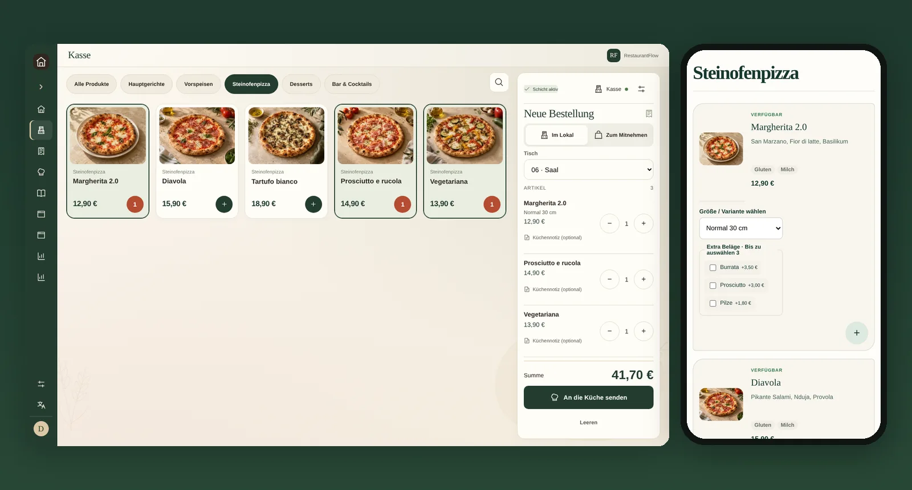

**[English version](README.en.md)** · **Stand: 27. Oktober 2026** · **[Projektstand und Verlauf](docs/PROJEKTSTAND.md)** · **[Prüfprotokoll](EVIDENCE.md)** · **[Selbst starten](#selbst-starten)**

## Auf einen Blick

- **Am Tisch:** Gäste scannen den QR-Code, lesen die Karte in ihrer Sprache mit EU-Allergenen, bestellen oder rufen den Service.
- **Im Service:** Das Service Radar sortiert Tische nach Wartezeit und nötiger Aktion. Die Kasse übernimmt Theke, Abholung und Bar- oder Kartenzahlung.
- **In Küche und Bar:** Jede Station sieht nur ihre Positionen und meldet sie als fertig.
- **Für den Inhaber:** Tagesbericht mit Zahlungsabgleich, Speisekarten-Editor, Website-Builder, Dienstplan und Stempeluhr.
- **Stand:** Läuft im Pilotbetrieb auf einem eigenen Server. Eine Fiskalkasse mit TSE ist nicht enthalten. Was genau getestet ist, steht [unten](#was-heute-umgesetzt-ist) und im [Prüfprotokoll](EVIDENCE.md).

RestaurantFlow ist das erste Produkt der Plattform FlowGastronomie. PizzeriaFlow, BarFlow, CaféFlow und ImbissFlow sollen auf demselben Kern folgen.

## Einblick in die Anwendung

Alle Bilder stammen aus der laufenden Anwendung mit dem fiktiven Demo-Betrieb „Restaurant Olive“: `npm run db:seed` legt ihn an, `npm run demo:showcase` spielt über die echte API einen Abend im Service durch (Produktfotos, Tische, offene Kasse, Bestellungen in jedem Küchenstatus, Zahlungen, Rufe vom Tisch). Es sind keine Mockups.

| Startseite des Inhabers                                                                                         | Kasse                                                                                                       |
| --------------------------------------------------------------------------------------------------------------- | ----------------------------------------------------------------------------------------------------------- |
| 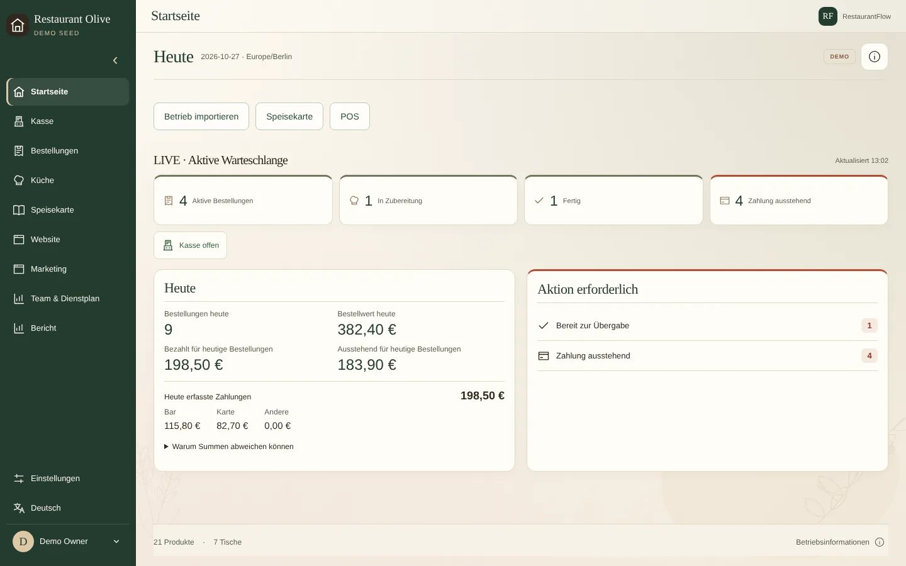 | 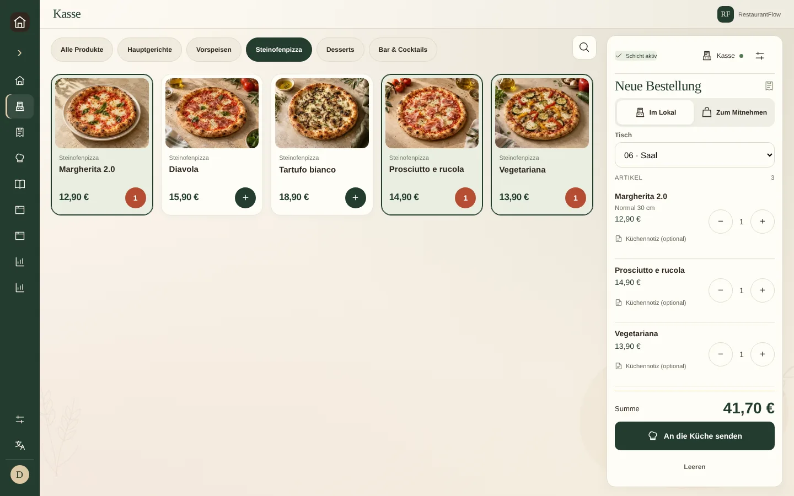 |

| Service Radar                                                                                                     | Küche                                                                                                               |
| ----------------------------------------------------------------------------------------------------------------- | ------------------------------------------------------------------------------------------------------------------- |
| 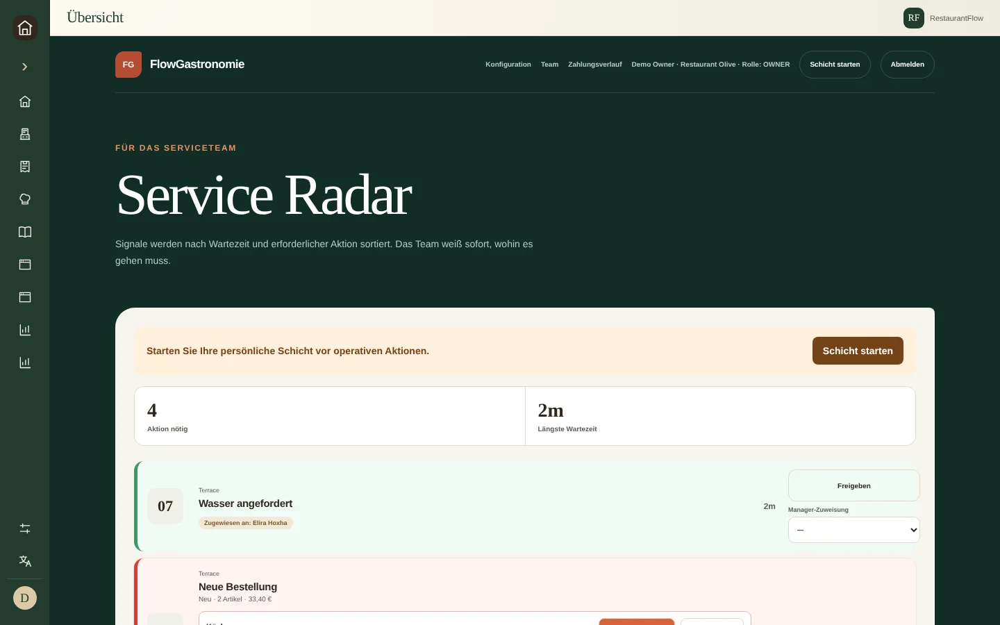 | 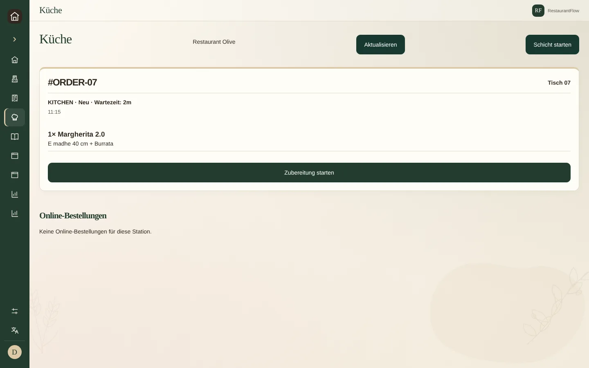 |

| Speisekarte verwalten                                                                                           | Tagesbericht                                                                                                       |
| --------------------------------------------------------------------------------------------------------------- | ------------------------------------------------------------------------------------------------------------------ |
| 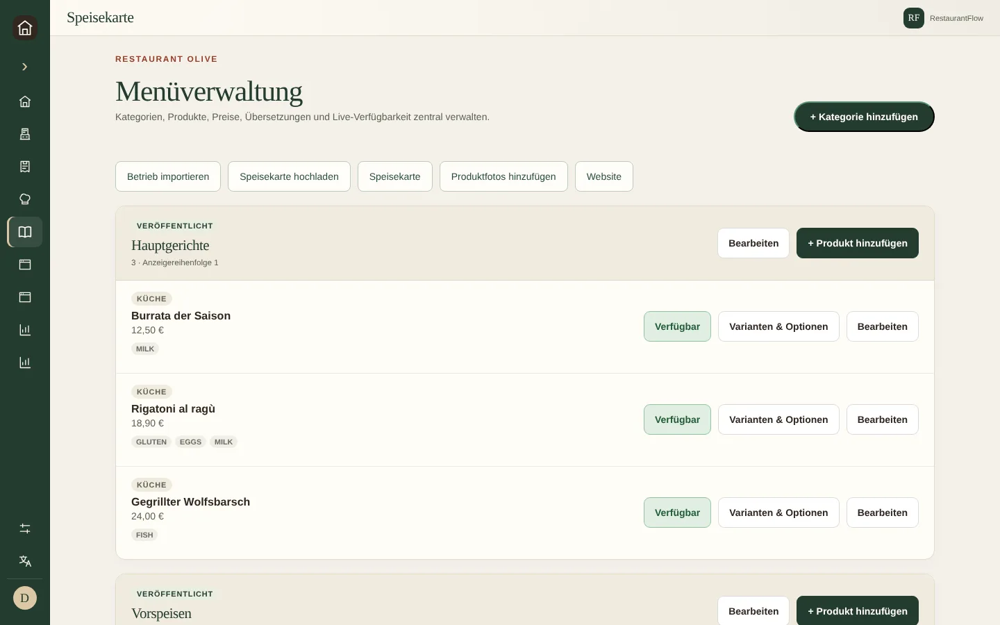 | 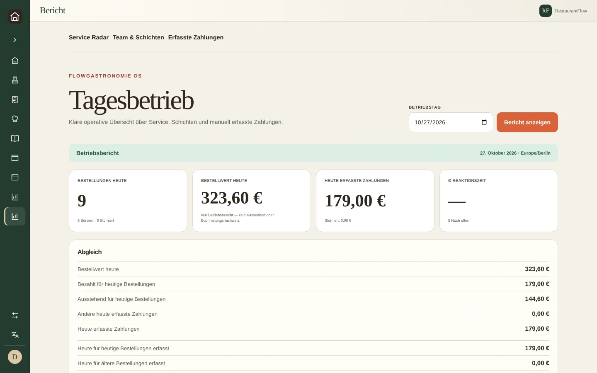 |

| Website des Lokals                                                                                          | Website-Builder                                                                                           |
| ----------------------------------------------------------------------------------------------------------- | --------------------------------------------------------------------------------------------------------- |
| 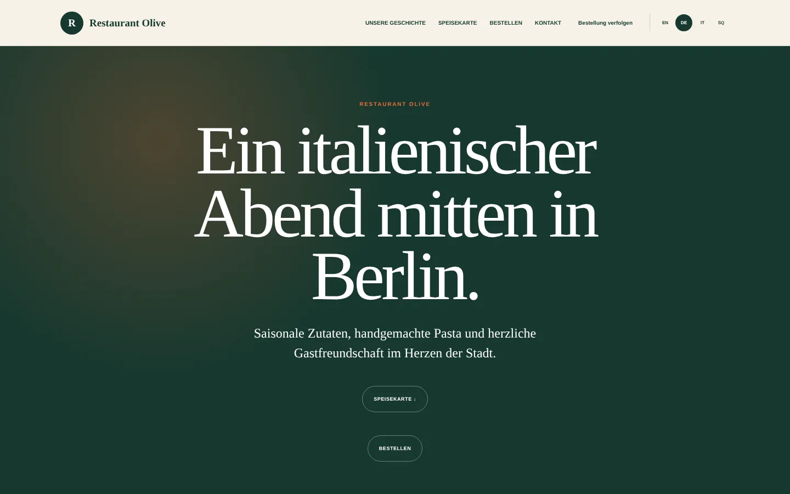 | 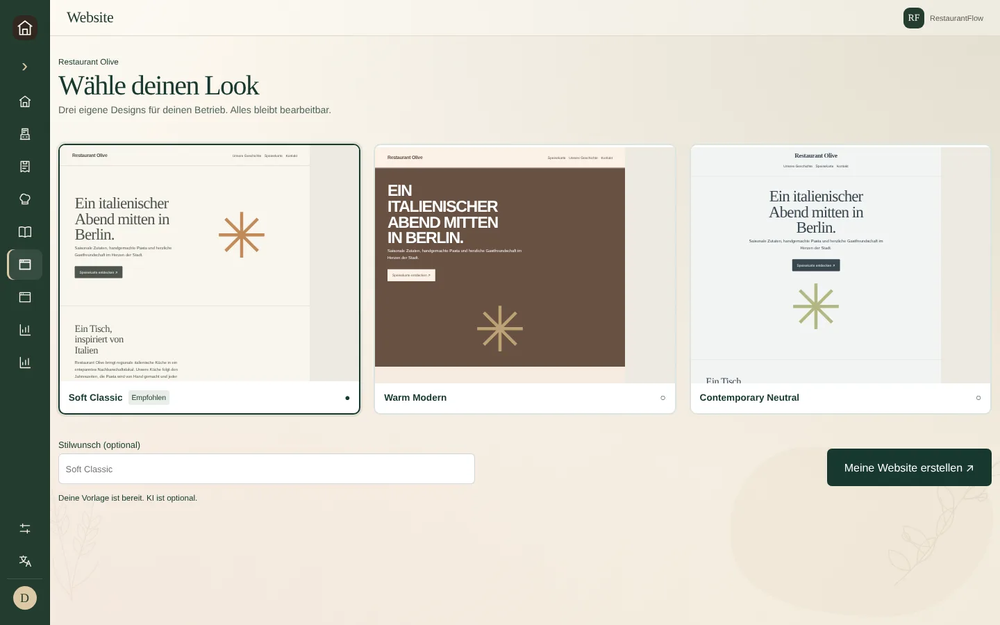 |

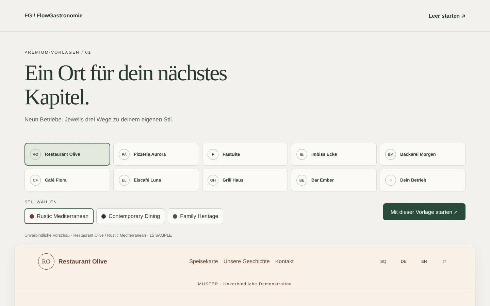

### Am Tisch (Handy, 390 px)

| Speisekarte nach QR-Scan                                                                                                                            | Website                                                                                                        |
| --------------------------------------------------------------------------------------------------------------------------------------------------- | -------------------------------------------------------------------------------------------------------------- |
| 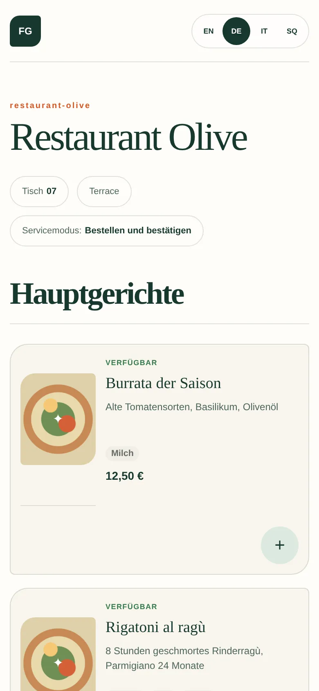 | 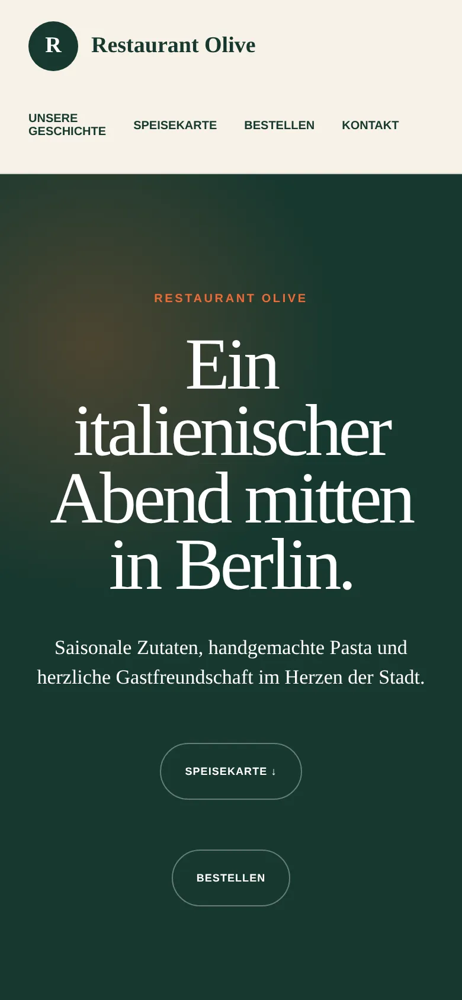 |

## Was heute umgesetzt ist

| Status                               | Bedeutung und Umfang                                                                                                                                                                                                                                                                                                                                                                                                                                                                                                                                                                                                                                                                                                                                                   |
| ------------------------------------ | ---------------------------------------------------------------------------------------------------------------------------------------------------------------------------------------------------------------------------------------------------------------------------------------------------------------------------------------------------------------------------------------------------------------------------------------------------------------------------------------------------------------------------------------------------------------------------------------------------------------------------------------------------------------------------------------------------------------------------------------------------------------------- |
| **Umgesetzt und getestet**           | Tisch-QR mit Speisekarte in 4 Sprachen (DE, EN, IT, SQ), EU-Allergene, Varianten und Extras; konfigurierbare Servicemodi pro Bereich und Tisch (nur Karte, Service rufen, Bestellen mit Bestätigung, Selbstbestellung); Service Radar; Kasse für Thekenverkauf mit Bar- und Kartenzahlung und Belegen; Küchen- und Barstationen; Online-Bestellung zur Abholung und Lieferung mit Sendungsverfolgung; Reservierungen; Speisekarten-Editor; Website-Builder mit drei Designs, Live-Vorschau und Veröffentlichung; Website des Lokals mit Warenkorb, eigener Domain, Impressum und Datenschutz; Rezepte und Wareneinsatz; Tagesbericht und Zahlungsabgleich; Dienstplan, Stempeluhr, Urlaub und Monatskonten; Rollen und Mandantentrennung; Abos mit Modul-Freischaltung |
| **Verifiziert**                      | Typprüfung, Formatprüfung, 718 Unit-Tests, 77 Integrationstests gegen PostgreSQL und Produktionsbuild lokal am 27.10.2026 auf dem Stand, der auch in Betrieb ist. Browser-Tests, SSE-Proxy und Backup-Probe laufen in der CI. Details im [Prüfprotokoll](EVIDENCE.md).                                                                                                                                                                                                                                                                                                                                                                                                                                                                                                 |
| **Im Pilotbetrieb**                  | Die Plattform läuft auf einem eigenen Server mit getrennter Produktionsdatenbank. Ein Pilotrestaurant nutzt die öffentliche Website mit Speisekarte und Abholbestellung; die Kassenanbindung an fiskaly wird nur mit der kostenlosen Sandbox getestet und ist noch nicht in diesem Repository.                                                                                                                                                                                                                                                                                                                                                                                                                                                                         |
| **Umgesetzt, nicht live abgenommen** | Transaktions-E-Mails (Brevo), KI-Import von Speisekarte und Website (OpenAI), Creative Studio für Plakate und Social-Media-Bilder, Web-Push, Android-Brücke für Bondrucker und Kassenschublade. Der Code ist vorhanden und mit Test-Doubles geprüft; mit echten Konten wurde er nicht betrieben.                                                                                                                                                                                                                                                                                                                                                                                                                                                                       |
| **Nicht enthalten**                  | Online-Zahlung, Fiskalkasse mit TSE, Buchhaltung, Liefer-Marktplatz. RestaurantFlow ist bewusst kein Kassensystem im Sinne der KassenSichV.                                                                                                                                                                                                                                                                                                                                                                                                                                                                                                                                                                                                                            |
| **Vision**                           | Pilotbetriebe in Deutschland und Albanien, weitere Betriebsarten (Pizzeria, Bar, Café, Imbiss) als Profil auf demselben Kern                                                                                                                                                                                                                                                                                                                                                                                                                                                                                                                                                                                                                                           |

## Warum dieses Projekt?

Viele kleine Restaurants stehen vor der Wahl zwischen Papierblock und einem großen Kassensystem, das den ganzen Ablauf umkrempelt. Dazwischen fehlt etwas: ein System, das nur dort hilft, wo es gerade eng wird. Auf der Terrasse dürfen Gäste selbst bestellen, im Saal bleibt der Kellner, und mittags läuft nur die Theke. Genau das konfiguriert der Betrieb in RestaurantFlow.

> **Digitalisiere nur, was du brauchst, ohne zu ändern, wie dein Restaurant funktioniert.**

## Architektur

```text
Browser (Gast, Team, Inhaber)
   │
   ▼
Next.js 16 Web ──► Fastify-API ──► Domäne (reine Regeln, Zustandsautomaten) ──► PostgreSQL
                      │
                      ├─► Server-Sent Events für Küche, Radar und Sendungsverfolgung
                      └─► optionale Dienste: Brevo, OpenAI, Web-Push, Android-Brücke
```

- **Modularer Monolith in einem npm-Workspace.** `apps/web` (Next.js), `apps/api` (Fastify), `packages/domain` (Geschäftsregeln ohne Framework), `packages/database` (Prisma-Schema, Migrationen, Repositories), `apps/android-pos-bridge` (Android-App für Drucker und Schublade).
- **Mandanten von Anfang an.** Jeder mandanteneigene Datensatz trägt `tenantId`, und Repository-Methoden verlangen Mandant und Lokal als Pflichtparameter.
- **Regeln in der Domäne.** Bestellstatus, Servicemodi, Preise und Berechtigungen liegen in `packages/domain` und werden nicht in UI oder Routen dupliziert. Preise rechnet immer der Server, Geld wird in Cent gespeichert.
- **Stack:** TypeScript strict, Next.js 16, React 19, Fastify 5, Prisma 6, PostgreSQL 17, Zod, Vitest, Playwright, Docker Compose, NGINX, GitHub Actions.

Mehr dazu in [docs/architecture/ARCHITECTURE.md](docs/architecture/ARCHITECTURE.md).

## Qualität und Sicherheit

- **CI auf jedem Pull Request:** Formatprüfung, Typprüfung, Unit-Tests, Integrationstests gegen eine frische PostgreSQL, Browser-Tests der Kernabläufe in vier Sprachen, SSE-Proxy-Test, Backup- und Wiederherstellungsprobe, Android-Build, gitleaks.
- **Sicherheit:** scrypt-Passwörter, serverseitige Sitzungen mit nur gehashtem Token in der Datenbank, Tisch-QR-Codes als nicht erratbare Tokens, Rate-Limits für alle öffentlichen Schreibzugriffe, Schutz gegen SSRF beim Website-Import. Bedrohungsmodell und bekannte Restrisiken stehen offen in [SECURITY.md](SECURITY.md).
- **Keine echten Daten.** Das Repository enthält keine echten Gäste, Mitarbeitenden oder Betriebe. Der Demo-Betrieb, seine Adresse, Telefonnummer und das Team sind erfunden.

## Selbst starten

Voraussetzungen: Node.js 22, npm 10, Docker (für PostgreSQL).

```bash
npm ci
cp .env.example .env
docker compose up -d postgres
npm run db:generate
npm run db:migrate
npm run db:seed
npm run dev:api      # http://localhost:4000
npm run dev:web      # http://localhost:3000
npm run demo:showcase  # optional: einen Abend im Service durchspielen
```

Danach öffnen:

- Gast am Tisch: `http://localhost:3000/de/menu/demo-table-07`
- Website des Lokals: `http://localhost:3000/de/venue/restaurant-olive-demo`
- Vorlagen: `http://localhost:3000/de/showcase`
- Team-Login: `http://localhost:3000/de/staff/login` mit `owner@flowgastronomie.local` und dem lokalen Testpasswort `Demo1234!`

```bash
npm run check              # Format, Typen, Unit-Tests, Build
npm run test:integration   # braucht die lokale PostgreSQL
npm run test:e2e           # Browser-Tests
npm run release:verify     # komplette Release-Prüfung wie in der CI
```

Weitere Demo-Wege, Prüfungen und die Repository-Karte: [docs/OPERATIONS.md](docs/OPERATIONS.md). Betrieb auf einem Server: [docs/operations/PRODUCTION_RUNBOOK.md](docs/operations/PRODUCTION_RUNBOOK.md).

## Wie dieses Projekt entsteht

FlowGastronomie wird von Redion Cekrezi entwickelt, mit KI-Agenten als Werkzeug: Der Mensch entscheidet, was gebaut wird, prüft jedes Ergebnis und gibt es frei; die Agenten schreiben Code, Tests und Dokumentation in kleinen Pull Requests, die nur mit grüner CI gemergt werden. Jede größere Entscheidung steht mit Datum im [Entscheidungslog](docs/product/DECISIONS.md).

## Dokumentation

| Thema                                         | Dokument                                                                                                   |
| --------------------------------------------- | ---------------------------------------------------------------------------------------------------------- |
| Wo das Projekt steht, was bisher passiert ist | [docs/PROJEKTSTAND.md](docs/PROJEKTSTAND.md)                                                               |
| Was geprüft wurde und wie                     | [EVIDENCE.md](EVIDENCE.md)                                                                                 |
| Bedrohungsmodell und Restrisiken              | [SECURITY.md](SECURITY.md)                                                                                 |
| Produktidee und MVP                           | [docs/product/PRODUCT_BRIEF.md](docs/product/PRODUCT_BRIEF.md), [docs/product/MVP.md](docs/product/MVP.md) |
| Plattform und Produktfamilie                  | [docs/product/PLATFORM_MASTER_PLAN.md](docs/product/PLATFORM_MASTER_PLAN.md)                               |
| Architektur                                   | [docs/architecture/ARCHITECTURE.md](docs/architecture/ARCHITECTURE.md)                                     |
| Lokaler Betrieb und Prüfungen                 | [docs/OPERATIONS.md](docs/OPERATIONS.md)                                                                   |

## Lizenz

Quellcode zum Lesen und Bewerten, nicht zur Nutzung im Betrieb: siehe [LICENSE](LICENSE). Für eine Nutzung oder Zusammenarbeit bitte über [GitHub](https://github.com/IamRedi) Kontakt aufnehmen.
