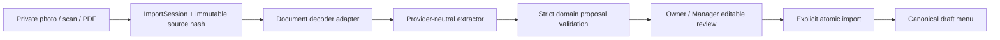

# Smart Setup and Menu Import — SI0 + SI1

The four-step workspace lives at `/app/{locale}/onboarding`: business type,
upload, review, import. Setup readiness is separate from venue activation.
The existing `/app/{locale}/launch` review remains the activation boundary.

## Canonical ownership

`BusinessProfileTemplate` remains the sole catalog of eight workflow profiles.
Public trial signup, demo/pilot provisioning and setup use the existing canonical
provisioner/category application. `SmartSetup` stores tenant/venue progress,
profile/version, applied profile receipts, skipped optional steps, active import
and optimistic version. Choosing a profile never copies a tenant or changes
ordering, website publication, promotions or fiscal settings. Optional category
defaults are drafts and are applied once per profile version; renamed categories
are not recreated on retry. Identity, timezone and currency continue to come
from the existing provisioner and venue configuration.

`ImportSession`, `ImportSource` and `ImportItem` are a review workspace, not a
second product catalog. Only the explicit commit writes existing `MenuCategory`,
`Product`, `ProductVariant`, `ProductModifierGroup` and option/allergen models.
Created products are unpublished and unavailable. Existing products are never
overwritten or automatically merged. Imported source text is reused as a
documented fallback across the four required translations until an operator
edits translations in the existing menu editor.

## Extraction and review boundaries



The API adapter accepts JPEG, PNG, WebP and unlocked PDFs. Sharp validates image
content and pixel limits; maintained PDF.js validates document structure/page
count. Filenames and declared MIME types are untrusted. Images reuse private
`MediaAsset` storage without becoming venue/product photography. PDF bytes are
private import-source documents, not product media. No unauthenticated import
source URL exists. Downloads use scoped staff authentication, `private,
no-store`, `nosniff` and a sandbox CSP. Original bytes and SHA-256 hashes remain
unchanged. The browser creates temporary authenticated blob previews and revokes
their URLs on unmount.

The domain schema requires per-field nullable values, confidence and evidence:
source ID, one-based page, observed quote and optional normalized coordinates.
Coordinates/pages must resolve inside this session. Missing prices remain null;
quoted amounts must support extracted prices and size deltas. Ambiguous numbers
require manual review. The schema rejects unknown fields, including tax config.
Currency must be explicitly reviewed against the venue currency. Canonical menu
prices use integer hundredths for all currencies, including ALL; locale display
precision is never used as a storage exponent.

Allergen candidates are unconfirmed. Only separately checked allergens on an
explicitly approved row enter canonical data. Approval also validates variant
defaults, nonnegative resulting prices and modifier selection limits through the
existing domain rules. Duplicate detection is advisory (normalized Unicode name
or overlapping name tokens); the operator rejects the row or explicitly chooses
a separate new product. Editing an approved row invalidates its approval.

## Consistency and audit

- Session/item review statuses: `DETECTED`, `NEEDS_REVIEW`, `APPROVED`,
  `REJECTED`, `IMPORTED`. Extraction has a separate pending/running/succeeded/
  failed state so a provider failure is never mistaken for a review decision.
- Active Owner/Manager membership is checked in tenant/venue scope. Composite
  foreign keys enforce session, source, selected category and imported-product
  ownership. Route bodies cannot provide tenant or actor authority.
- Per-venue PostgreSQL advisory locks and expected versions serialize mutations.
  Review, category creation, product/options creation and receipt persistence
  commit atomically; canonical duplicate checks run again at commit time.
- A session creation request key is idempotent. Identical uploaded bytes are
  deduplicated within a session. A committed session returns the same product IDs
  even when a retry carries an old expected version. New sessions still require
  review and a fresh duplicate decision.
- Source hashes, proposal, model/provider, prompt hash, provider request ID,
  usage, latency, review actor/time and changed field names are retained. Product
  provenance links back to that review. Sensitive provider errors never reach UI.

## Provider configuration and operational limits

Extraction is disabled by default. Configure only on the server:

```dotenv
MENU_IMPORT_PROVIDER=openai
MENU_IMPORT_MODEL=gpt-5-mini
MENU_IMPORT_OPENAI_API_KEY=...
```

An empty dedicated key falls back to the existing `CREATIVE_OPENAI_API_KEY`.
Normal users see no model/quality controls. The OpenAI adapter uses Responses
structured output with image/PDF input, `store: false`, and no business-writing
tools. Provider processing still transmits the selected menu files to OpenAI;
deployments must configure credentials and their data-handling policy explicitly.
No live provider call was needed for this milestone; automated extraction is
dependency-injected and controlled. Live OCR accuracy is not claimed by mocked
acceptance.

Limits: 4 files, 20 pages, 10 MB/file, 24 MB/session, 20 million image pixels,
150 proposed items, 20 sessions/venue/day and 3 explicit extraction attempts per
session. The provider timeout is 150 seconds. There are **no automatic retries**.
An interrupted job becomes failed after 180 seconds when progress is read; it
does not restart. A retry with the same extraction key never calls the provider
again. A deliberate retry uses a new key and counts toward the attempt cap.
Progress and completed proposals survive reloads. Files remain private review
evidence in PostgreSQL/backups; no new public media promotion or retention purge
policy is introduced in SI0/SI1.

If extraction is unavailable, optional menu import can be skipped and the
canonical menu editor remains usable. A new import is required to replace source
files after extraction. Source/provenance details and sizes/extras/allergens are
secondary disclosures; default review emphasizes name, category and price.

## Verification and local review

Focused commands (local PostgreSQL only; isolated schemas are removed afterward):

```powershell
npm run test --workspace=@flowgastronomie/domain -- src/smart-setup.test.ts src/menu-import.test.ts
npm run test --workspace=@flowgastronomie/api -- src/menu-import-adapters.test.ts
npx dotenv -e .env -- node tests/setup/run-db-gate.mjs si0
npx dotenv -e .env -- node tests/setup/run-db-gate.mjs si1
npx dotenv -e .env -- node tests/setup/run-browser-gate.mjs
```

`npm run test:setup` combines the two PostgreSQL gates and browser acceptance.
CI runs this focused gate before the existing release gate. Fixtures and mock
extractor live under `tests/setup`; no production mock toggle exists. The fixture
server binds to loopback and requires a guarded test schema.

Acceptance always provisions fresh synthetic DEMO/REAL fixtures in a generated
local schema. `--local` is retired and rejected. No precreated customer tenant,
local credentials file or customer asset is required. The Import V2 browser gate
starts from an empty schema and registers each business through `/v1/public/trials`.

Inventory, barcode, receipt/depletion, invoice extraction and batch product-photo
matching remain later milestones. No M2/M3, fiscal, gift-card or promotion
activation work is included.
