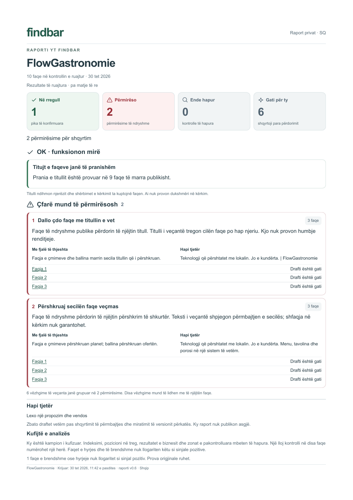
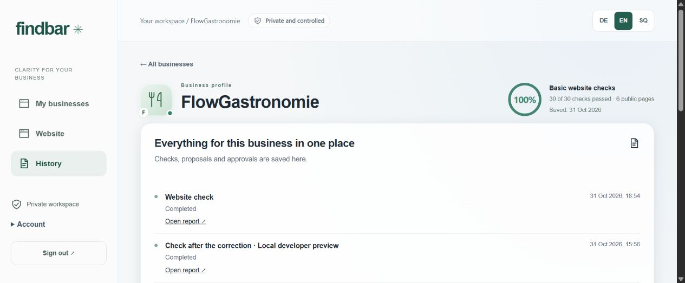

# Findbar × FlowGastronomie

A real website improvement case study, 30–31 October 2026.

**Two grouped topics · three pages · six corrected fields · zero confirmed
findings after the public recheck.**

Findbar found the same browser title and search description on three Albanian
pages of FlowGastronomie. The owner reviewed concrete proposals. The developer
implemented the six texts, verified a private preview and published with explicit
approval. Findbar then checked the real public website again: ten URLs and zero
confirmed findings. The large visible headings inside the pages stayed the same.

## Before

## After the authorised publication

The audit visited ten URLs. Its 100% indicator means 30/30 basic checks on six
eligible public pages. Search rankings, indexing, AI visibility and Core Web
Vitals were outside this measurement. Findbar is a local application pending
final owner UAT. The developer performed this production release; it does not
demonstrate unattended publication to arbitrary client websites.

[Full English case study](CASE_STUDY_EN.md) · [Deutsche Fallstudie](CASE_STUDY_DE.md) ·
[Exact before/after values](evidence.json)

[Presentation PDF — Deutsch](Case_Study_DE.pdf) ·
[Presentation PDF — English](Case_Study_EN.pdf)

These presentations explain the complete workflow with real screenshots.
Earlier videos remain dated drafts in the owner's private studio.
No new paid AI call or new audit was needed to document this retained evidence.
